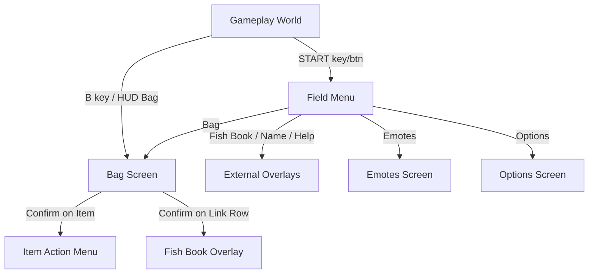

# Game Menu System (START & BAG)

*Architecture specification for the in-screen Game Boy / arcade menu system.*

---

## 1. Overview & Screen Tree

The in-screen menu is governed by a pure TypeScript state machine (`menuModel.ts`) subscribed to by `useGameMenu.ts` and drawn by React components (`GameMenu.tsx`, `BagScreen.tsx`, `StartMenu.tsx`).

---

## 2. Input Rules & Controller Mappings

- **Single Input Router**: Every input (keyboard, virtual Game Boy D-pad, mouse click, screen tap) passes through `store.press(input)` or `store.point(index, confirm)`.
- **D-Pad & Arrow Keys**:
  - `↑` / `↓`: Vertical navigation with wrap-around across rows.
  - `←` / `→`: Pocket switching in Bag (wraps across `ITEMS` ↔ `FISH` ↔ `CARDS` ↔ `KEY`); value adjustment in Options.
  - Held inputs: Initial delay of ~380 ms (`DPAD_REPEAT_DELAY_MS`), repeating every ~120 ms (`DPAD_REPEAT_EVERY_MS`).
- **Confirm (◯ / Enter / Z / E / O / tap)**:
  - On Item: Opens the contextual Action Menu (`Eat`, `Check`, `Cancel`).
  - On Link Row: Emits link effect (e.g., `{ type: 'fishbook' }`), closing the menu to present the target overlay.
- **Back (✕ / Escape / X)**:
  - Exactly one level per press: Action Menu → Bag → Field Menu → Gameplay.
  - Menus opened directly (via B or HUD) exit directly back to gameplay on Back.
- **START (M / P / ` / Shell START)**:
  - Immediately dismisses the entire menu system from any sub-level or popup.

---

## 3. Pocket Structure & Item Display

Pockets display items carried in the active save:

| Pocket | Item Source | Content Details | Empty State Notice |
| :--- | :--- | :--- | :--- |
| **ITEMS** | `story.bag` (Dalbit items) | Consumables, everyday goods | `"Nothing here yet."` |
| **FISH** | Story fish (`story.bag`) in story rooms; Caught free fish (`freeFish`) in world rooms | Lists each fish species user has, with count (`×N`), sprite icon, tier, and best size | `"No fish yet. Cast a line at the Lake Pier."` |
| **CARDS** | `story.bag` (Memory disks) | Card disks; supports generic link to album in future | `"No cards yet."` |
| **KEY** | `story.bag` (Tools/passes) | Key story tools | `"No key items yet."` |

### Fish Pocket Behavior
1. **Direct Fish Listing**: Instead of burying catches behind a single aggregate row, each caught fish species appears as its own interactive row (`Sardine ×3`, `Red Sea Bream ×1`).
2. **Showcase Sprite & Inspect Details**: Selecting a fish displays its crisp pixel sprite in the left showcase tile (replacing the generic backpack icon), while the species flavor note, tier, and best catch length appear below in the full-width description box.
3. **Item Actions**: Pressing Confirm (◯) on a caught fish provides a `Check` action that shows species details.
4. **Empty State**: An empty fish pocket displays `"No fish yet. Cast a line at the Lake Pier."` in the list area and `"Nothing in this pocket yet."` (or Mother's line in story rooms) in the description box.
5. **Generic Link Rows**: `linkIn` remains supported in `menuModel.ts` for pockets that require linking to full-screen albums (e.g. CARDS → Card Album in future).

---

## 4. Single-Message Empty State Design

To avoid doubled empty messages (previously appearing simultaneously in both the list and description box):
- **List Area**: Shows a short, centered, pocket-specific prompt (e.g., `"No fish yet. Cast a line at the Lake Pier."`).
- **Description Box**:
  - In story rooms (`isStoryRoom`): displays Mother's line (*"Empty. Mother would say that's a good sign you haven't lost anything yet."*).
  - In world rooms: displays a neutral hint (*"Nothing in this pocket yet."*).
  - When the cursor rests on the FISH BOOK row: displays the Fish Book guide copy (*"Fish from the bay go to your Fish Book. Show new catches to Nami or Kai to record them."*, dropping the second sentence for guests).

---

## 5. Limits & Constraints

- **Single Active Popup**: When an item action popup is open, horizontal inputs and background item list selections are locked.
- **No Story Item Contamination**: Free fish caught at the Poolside or Lake Pier never enter `story.bag`. They are tracked in `FishBook` and recorded through Nami/Kai.
- **Performance**: Zero re-renders of background canvas; input gating prevents rapid accidental double-activation on physical touchscreen controls.
